# Evidencias del Hito 2: despliegue funcional de Cofrial SpA en AWS Academy

- **Equipo:** Benjamín Aguilar y Daniel Jara · TIEL15 Transformación Digital · INACAP Temuco
- **Fecha de las pruebas:** 14 de noviembre de 2026
- **Cuenta:** AWS Academy Learner Lab, región `us-east-1`
- **Código:** <https://github.com/Drakn-Sub/cofrial> (ramas `benjamin` y `daniel` integradas en `main`)

## Resumen

El ecosistema completo de Cofrial está desplegado y conectado en AWS: **tienda B2B/B2C con carrito (django-oscar)**, **CRM**, **torre de control IoT** alimentada por **50 camiones simulados en Docker**, **dashboard de Metabase** que cruza ventas con alertas de frío, e **IA gratuita (Gemini)** que clasifica los mensajes de clientes en el CRM.

Antes de construir auditamos la infraestructura inicial y corregimos 10 hallazgos (2 críticos), detallados en [`01-auditoria-inicial.md`](01-auditoria-inicial.md). El resultado se verifica con pruebas automáticas: **29 de 29 controles de seguridad** desde fuera y **20 de 20 controles de privilegios** en la base de datos real.

| Canal | Dirección | Usuario de prueba |
| --- | --- | --- |
| Tienda (público y convenios) | <https://tienda.cofrial-temuco.duckdns.org> | `compras@hospital-demo.cl` (B2B) |
| CRM | <https://crm.cofrial-temuco.duckdns.org> | `vendedor@cofrial.cl` (con 2FA) |
| Torre de control IoT | <https://ops.cofrial-temuco.duckdns.org> | `despacho@cofrial.cl` (con 2FA) |
| Dashboard de BI | <https://bi.cofrial-temuco.duckdns.org/dashboard/2> | administrador de Metabase |

Las contraseñas no están en este documento ni en el repositorio.

---

## 1. Despliegue cloud en AWS Academy (EC2 + RDS)

### Arquitectura desplegada

```
Internet ──> NLB (2 IP elásticas, 1a y 1b) ──> ALB interno (TLS, certificado ACM *.cofrial-temuco.duckdns.org)
                                                  │  reglas por nombre: tienda / crm / ops / bi
                         ┌────────────────────────┴────────────────────────┐
              cofrial-app-a (10.20.11.0/24, us-east-1a)        cofrial-app-b (10.20.12.0/24, us-east-1b)
              Nginx + Django/Gunicorn + Metabase (Docker)      Nginx + Django/Gunicorn + Metabase (Docker)
                         └────────────────────────┬────────────────────────┘
                                                  │ 5432 con TLS verify-full
                         RDS PostgreSQL 16 Multi-AZ (10.20.21.0/24 y 10.20.22.0/24), cifrada
                                                  ▲
              cofrial-iot (10.20.31.0/24): simulador de 50 camiones en Docker, rol iot_ingest
```

| Componente | Configuración | Por qué |
| --- | --- | --- |
| VPC `10.20.0.0/16` | 7 subredes: 2 públicas, 2 de aplicación, 2 de datos y 1 IoT | Una subred por capa y por zona: si cae una zona, la otra sigue atendiendo |
| Balanceo | NLB con IP fijas → ALB interno con HTTPS | DuckDNS necesita una IP fija; el ALB termina TLS y reparte entre las dos zonas |
| EC2 de aplicación | 2 instancias Amazon Linux 2023, **sin IP pública, sin llave SSH**, IMDSv2 obligatorio, disco gp3 cifrado | Superficie mínima; se administran con Session Manager |
| RDS PostgreSQL 16.13 | **Multi-AZ** (primaria en 1a, réplica en 1b), cifrada, no pública, respaldos de 7 días | Persistencia gestionada con conmutación automática ante fallas |
| Secrets Manager | `cofrial/app`, `cofrial/iot`, `cofrial/github`, `cofrial/duckdns` y la clave maestra de RDS gestionada por RDS | Ninguna credencial en el código ni en los servidores en texto plano |
| S3 `cofrial-media-605885` | Privado, cifrado, solo HTTPS; imágenes con URL firmadas de 1 hora | Las fotos de producto se comparten entre los dos nodos sin exponer el bucket |
| Simulador IoT | Nodo dedicado en subred IoT | Cumple el requisito de nodo contenerizado separado |

**Evidencias:**
- Antes, servidor público con SSH abierto: 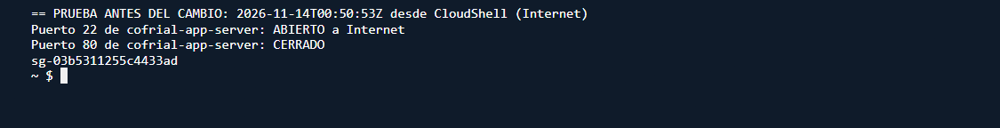
- Después, cerrado: 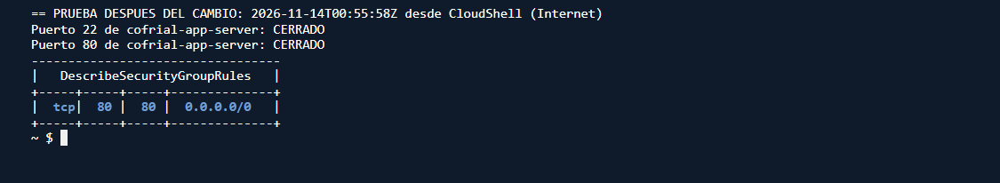
- Secretos generados en Secrets Manager: 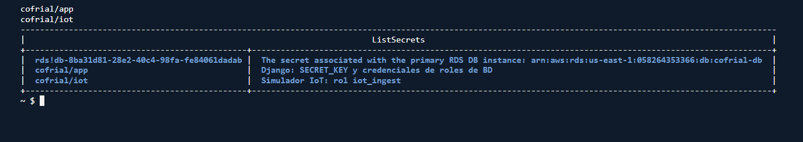
- Configuración verificada por API (sin IP pública, IMDSv2, EBS y RDS cifrados, Multi-AZ, respaldos): ver la sección 4 de las [pruebas de seguridad](evidencias/03-pruebas/pruebas-seguridad-2.png).

**Persistencia:** los contenedores tienen `restart: unless-stopped` y vuelven solos cuando AWS Academy reinicia el laboratorio. El balanceador revisa `/salud/`, que consulta PostgreSQL además de Nginx.

---

## 2. E-commerce transaccional y CRM operativo

### Tienda (django-oscar 4)

- **Catálogo:** 20 productos refrigerados y congelados, con imagen, descripción, SKU y stock, leídos desde RDS. Las imágenes están en S3 privado.
- **Perfiles B2B y B2C:** al entrar como cliente institucional, la tienda aplica la **lista de precios del convenio** (`PrecioConvenio` en `apps/partner/strategy.py`). El público general ve el precio de catálogo. Si el convenio vence, el cliente vuelve al precio público (cubierto por una prueba automática).
- **Carrito y órdenes:** flujo estándar de Oscar (carrito → despacho → pago → orden) con estados en español: Recibido, Pagado, En preparación, Asignado, En ruta, **En ruta con alerta**, Entregado, Rechazado y Anulado. Oscar rechaza cualquier transición que no esté en esa lista.
- **Datos de demostración:** 216 pedidos en 60 días, de 4 instituciones con convenio y 14 clientes B2C, todos ficticios.

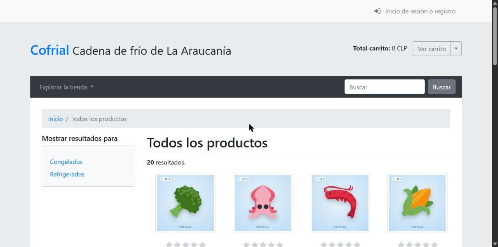

### CRM

- **Embudo:** Prospecto → Contactado → Calificado → Propuesta → Negociación → Ganado / Perdido, con 13 oportunidades. El tablero Kanban permite mover las tarjetas.
- **Autorización por objeto:** cada vendedor ve y mueve **solo sus oportunidades**; la jefatura ve todas.
- **Conexión con la tienda:** cada pedido web crea una interacción en la ficha del cliente. Si un camión pierde la cadena de frío, la interacción se crea sola con urgencia ALTA.
- **Conversión:** un prospecto se convierte en cliente B2B con una acción del administrador.

---

## 3. Simulación IoT con Docker en EC2

- **Contenedor** `iot/simulador.py` en el nodo `cofrial-iot`: 50 camiones (CF-001 a CF-050) envían cada **30 segundos** exactamente los campos exigidos: `camion_id`, `temp_camara`, `lat`, `long`, `combustible_pct` y `alerta_ruptura_frio`.
- Los camiones se mueven por La Araucanía; los pares son congelados (−25 a −18 °C) y los impares refrigerados (0 a 4 °C).
- **Falla programada para la demo:** **CF-027** pierde el frío durante 10 minutos de cada hora.
- **Seguridad:** el contenedor se conecta con el rol `iot_ingest`, que **solo puede insertar** telemetría. No puede leer ni borrar datos. Usa TLS `verify-full` y se reconecta solo si RDS conmuta de zona.
- **Escala:** la tabla `logistica.telemetria` está particionada por mes y tiene índice BRIN.
- **Alertas automáticas:** cada minuto, `evaluar_alertas` revisa las dos últimas lecturas de cada camión. La histéresis evita falsas alarmas por una lectura aislada. Al abrir una alerta:
  1. marca los pedidos del camión como "En ruta con alerta";
  2. deja la interacción en el CRM del cliente;
  3. lo registra en la auditoría.
- **Torre de control:** mapa en vivo de la flota con los camiones fuera de rango en rojo, tabla de temperaturas y alertas activas. El despachador las toma y registra la acción.

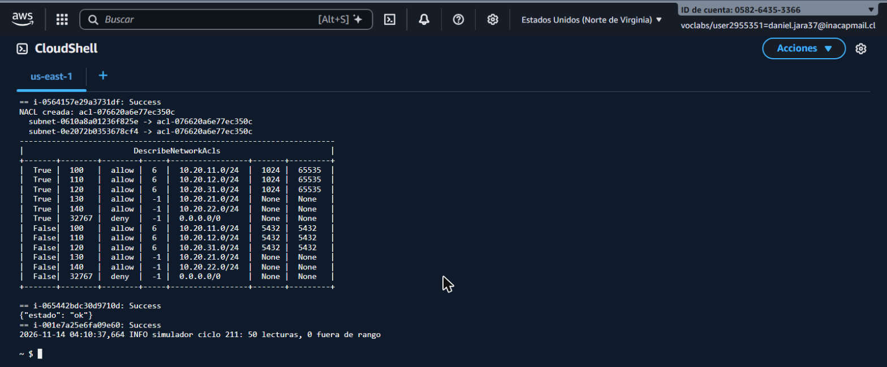

---

## 4. Dashboard de Business Intelligence

Metabase corre en los mismos nodos y se conecta a RDS con el rol `bi_reader`, que **solo lee 5 vistas agregadas del esquema `bi`, sin nombres, RUT ni correos**. El dashboard "Cofrial · Torre de control gerencial" tiene 12 paneles que **cruzan lo comercial con lo operativo**:

| Comercial (tienda y CRM) | Operativo (IoT) |
| --- | --- |
| Ventas de los últimos 30 días y pedidos | Camiones fuera de rango en este momento |
| Ventas semanales por canal B2B/B2C | Mapa de la flota con su última posición |
| Participación B2B/B2C | Temperatura de la flota en vivo (fila roja si está fuera de rango) |
| Oportunidades por etapa y pipeline ponderado | Alertas de frío por día y **pedidos afectados por alertas** |

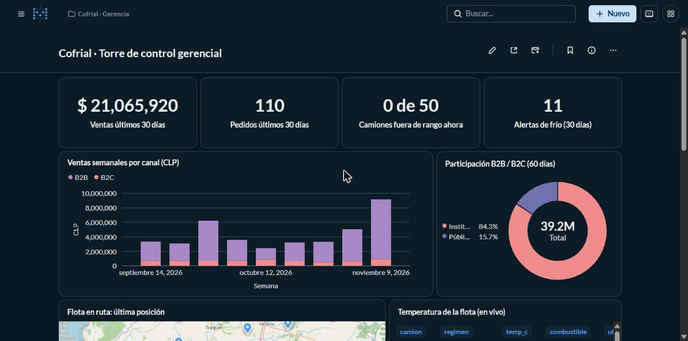
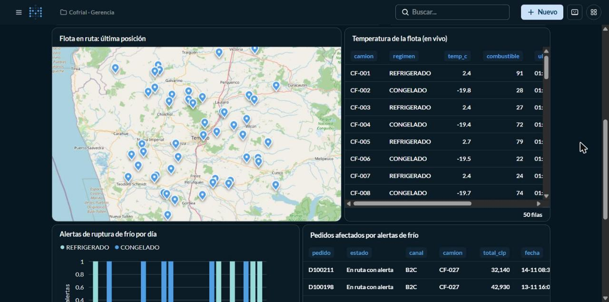
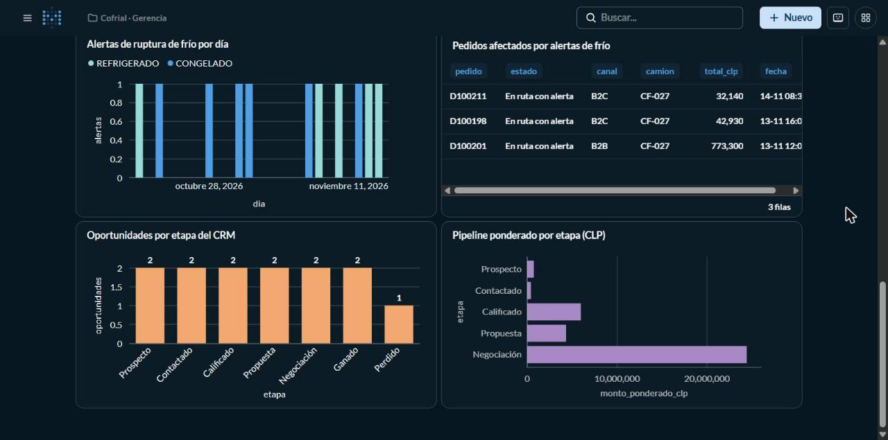

---

## 5. Integración de IA de costo cero

- **Servicio:** API de Google Gemini (AI Studio, plan gratuito), modelo `gemini-flash-lite-latest`.
- **Uso:** cada mensaje de cliente en el CRM se clasifica al guardarse en **Reclamo, Cotización, Despacho, Facturación u Otro**, con urgencia **Alta, Media o Baja**.
- **Controles (OWASP Top 10 para LLM):**
  - **seudonimización:** se quitan RUT, correos y teléfonos antes de enviar el texto;
  - **delimitador anti-inyección;**
  - **lista cerrada** que valida la respuesta;
  - texto truncado, tiempo máximo de 10 s y clave en Secrets Manager.
  - **Falla segura:** sin respuesta, el mensaje queda "Sin clasificar" y el CRM sigue funcionando.
- **Prueba en AWS:**
  - "Necesito cotizar 300 kg de pechuga de pollo" → **COTIZACIÓN / MEDIA**.
  - "El camión no ha llegado y tenemos el almuerzo de los pacientes en 1 hora" → **DESPACHO / ALTA**.

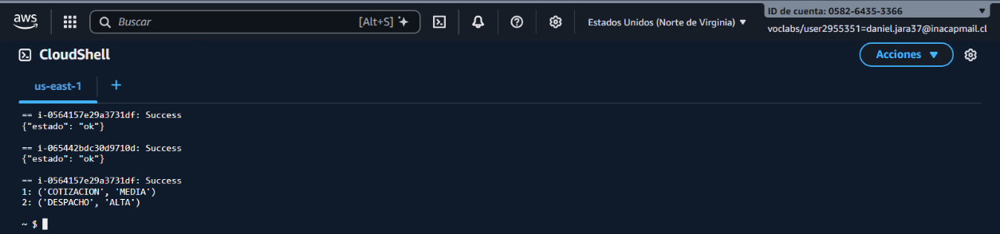

---

## 6. Seguridad y DevSecOps

### Pruebas desde fuera: 29 de 29 pasan

Script [`infra/scripts/pruebas_seguridad.sh`](../infra/scripts/pruebas_seguridad.sh), ejecutado desde CloudShell sin contraseñas:

| Grupo | Controles verificados |
| --- | --- |
| Cifrado | HTTP→HTTPS 301, certificado válido, TLS 1.3, HSTS de 1 año con preload, X-Frame-Options DENY, nosniff, servidor sin versión, cookies Secure y SameSite |
| Superficie | `/admin/`, `/dashboard/`, `/crm/` y `/ops/` **no existen** en la tienda (404); el CRM exige sesión; `.env` no está expuesto |
| Fuerza bruta | 8 intentos seguidos: los 4 primeros son rechazados y **desde el 5.º responde 429 (bloqueado)**. Nginx limita la frecuencia y django-axes bloquea tras 5 fallos |
| AWS | sin IP pública, IMDSv2, EBS cifrado, sin llaves SSH, ningún SSH a internet, RDS privada, cifrada, Multi-AZ y con respaldos, S3 bloqueado, solo TLS y 403 sin firma, 5 secretos, NACL de datos y servidores antiguos detenidos |

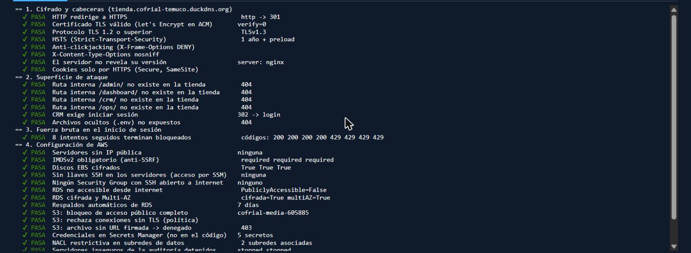
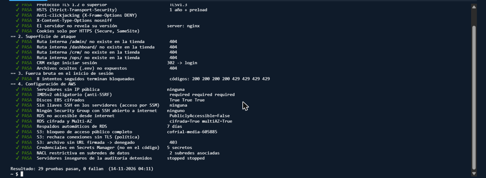

### Mínimo privilegio en la base de datos: 20 de 20

| Rol | Puede | No puede |
| --- | --- | --- |
| `cofrial_app` (Django) | leer y escribir datos de negocio; **insertar** auditoría | modificar ni borrar la auditoría; DROP, TRUNCATE, CREATE; inventar telemetría |
| `iot_ingest` (sensores) | **solo insertar** telemetría | leer clientes, usuarios o telemetría; borrar |
| `bi_reader` (Metabase) | leer las vistas agregadas del esquema `bi` | leer usuarios, clientes o pedidos detallados; crear objetos |
| `cofrial_migrate` | crear y alterar tablas | solo se usa durante el despliegue |

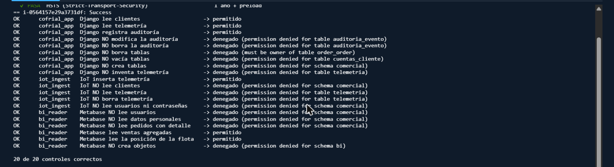

### Defensa en profundidad

- **Red:** Security Groups encadenados (ALB → app → RDS), **NACL** en datos (solo 5432 desde app e IoT), subred de datos sin ruta a internet y endpoint de S3.
- **Aplicación:**
  - segundo factor TOTP obligatorio para todo el personal interno;
  - Argon2 para las contraseñas;
  - bloqueo tras 5 intentos;
  - autorización por objeto (anti-IDOR);
  - protección de redirección abierta;
  - CSRF.
- **Auditoría solo inserción:** los inicios de sesión, los fallos, las alertas y los pedidos quedan en `seguridad.auditoria_evento`, que Django puede escribir pero no alterar.
- **Contenedores:** sistema de archivos de solo lectura, `cap_drop: ALL`, `no-new-privileges` y usuario sin privilegios (uid 10001).
- **Datos personales (Ley 19.628 / 21.719):** consentimiento registrado por cliente, seudonimización hacia la IA y BI sin datos personales.
- **Pipeline `ci-seguridad` en GitHub Actions**, en cada push:
  - Gitleaks (secretos);
  - Bandit (código Python);
  - pip-audit con SBOM CycloneDX (dependencias);
  - migraciones con el rol restringido;
  - prueba de privilegios;
  - 23 pruebas automáticas;
  - `check --deploy`.
  - OWASP ZAP disponible bajo demanda (`zap.yml`).

### Riesgos aceptados

| Riesgo | Motivo | Compensación |
| --- | --- | --- |
| Cuenta de estudiante sin MFA en AWS | Limitación de AWS Academy | 2FA en la aplicación y acceso solo por Session Manager |
| Subdominio gratuito (DuckDNS) | Sin presupuesto para un dominio | Certificado válido de Let's Encrypt importado en ACM |
| Laboratorio con sesiones de 4 horas | Limitación de AWS Academy | Todo se levanta solo al reiniciar el laboratorio |

## Cómo reproducir las pruebas

```bash
# En AWS CloudShell
bash ~/cofrial/infra/scripts/pruebas_seguridad.sh          # 29 controles externos
# En un nodo de aplicación (Session Manager o SSM Run Command)
sudo bash /opt/cofrial/infra/scripts/verificar_privilegios_nodo.sh   # 20 controles de BD
```
